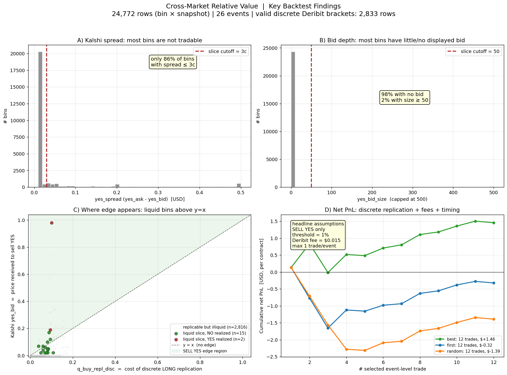

# The journey: problems and how I solved them

This project is best understood as a sequence of problems, each of which broke
the previous design and forced a more honest one. The interesting content is
the failures, not the final pipeline.

### Problem 0 — The markets don't line up

The original idea was naive: extract a risk-neutral probability from Deribit
at some expiry `T`, read the Kalshi contract at the same `T`, compare, trade
the difference. **It doesn't work**, because the two instruments never share
an expiry: Kalshi `KXBTC` only lists *hourly intraday* binaries (settled on a
60-second BRTI average at the top of each hour), while Deribit options only
expire at **08:00 UTC** (daily/weekly/monthly). There is no Deribit expiry at
3pm on a Tuesday.

**Solution:** redesign around an *intraday horizon*. Price the Kalshi bin that
settles at `T_K` (minutes away) using the nearest Deribit expiry `T_D > T_K`
(hours away), and bridge the gap with a term-structure assumption.

### Problem 1 — There is no volatility at `T_K`, only at `T_D`

The Deribit smile gives implied vol at `T_D`, not at the much shorter `T_K`.

**Solution:** VLT scaling (variance linear in time): assume `σ_imp(K)` is
horizon-independent, so the implied vol read off the `T_D` smile is reused to
compute `P^Q(L ≤ S_{T_K} ≤ U) = N(d2(L)) − N(d2(U))` under Black–Scholes at
`T_K`. This is the central — and most contestable — modelling assumption, and
the backtest later quantifies exactly how well it holds by horizon.

### Problem 2 — Option quotes are discrete, noisy, and incomplete

Raw Deribit strikes are sparse and bid/ask-noisy; a per-strike probability is
unstable.

**Solution:** fit an **SVI raw 5-parameter** smile (`src/model/svi.py`),
OTM-only (puts for `K<F`, calls for `K≥F`), weighted by `1/spread`, with the
put–call-parity forward `F = K + e^{rT}(C−P)` from ATM pairs. This yields a
continuous density instead of noisy point estimates. The fit is bounded but
has no butterfly or calendar no-arbitrage constraint, so it is not guaranteed
arbitrage-free. Sanity
check enforced in the backtest: `Σ q_deribit ≈ 0.9999` over the strip.

### Problem 3 — A mid-price probability is not tradable

`q_deribit` uses option *mid* prices. You cannot trade a mid: you pay the ask
and receive the bid.

**Solution:** fit **three SVI curves** (`src/model/exec_price.py`) — `svi_mid`
(theoretical), `svi_bid` (worst case shorting the Deribit hedge), `svi_ask`
(worst case going long) — producing `q_buy_exec`/`q_sell_exec`, the actual
cost to go long/short the replication.

### Problem 4 — Even a bid/ask probability isn't what you trade

You don't trade a density; you trade *discrete Deribit verticals*. Deribit
strikes are $500–$1000 apart; Kalshi bins are $100 wide. A Kalshi binary
cannot be replicated — the closest construct is a call vertical paying a
triangular ramp over a 5× wider range, with structural tracking error.

**Solution:** `src/model/replication_discrete.py` finds the real strikes
`K_low ≤ L < U ≤ K_high` bracketing each bin, builds the executable vertical,
and prices it net of cost. **Discovery:** only **14% of bin-snapshots** have a
valid executable bracket at all (panel A/B of the figure) — the other 86% are
unhedgeable in practice. This single number reframed the whole project.

### Problem 5 — The first backtest "made money" (it didn't)

An early backtest with a "best opportunity per event" aggregation showed
positive PnL. It was an artifact: picking, with hindsight, the best of several
correlated snapshots inside the same event.

**Solution:** the backtest (`src/runner/backtest.py`) now de-correlates
snapshots per event with three modes — *best* (optimistic, kept only to show
the bias), *first* (realistic timing), *random* (control) — and charges the
**official Kalshi fee** `ceil(0.07·p·(1−p))` plus a Deribit constant. Under
realistic timing the edge disappears (panel D). This is the project's core
result and the reason it exists.

### Problem 6 — 60-second REST snapshots are too stale to trust

A fixed 60s poll mixes fresh and stale quotes and cannot measure how fast any
signal decays.

**Solution:** an **event-driven collector** (`src/event_snapshotter.py`) that
polls fast but only persists a snapshot when bid/ask/size *state changes* on
either venue, writing the same schema so the backtest runs unchanged on it.
Its `changed_side` metadata is fed into the backtest to test the "edge appears
when Kalshi moves but Deribit hasn't" hypothesis (it doesn't, materially). The
canonical run uses this dataset.

### Problem 7 — Bad SVI fits silently poison the metrics

Some expiries are illiquid or stale; a bad fit produces confident-looking but
garbage probabilities.

**Solution:** an expiry **quality score** (`src/model/quality.py`) and a
bootstrap confidence interval on the SVI fit, available as a backtest filter
and a per-bin diagnostic.

### Problem 8 — The documentation claimed numbers nothing could reproduce

The earlier README headline (26 events, a different Brier, a "+$1.46" PnL)
matched **no committed artifact**. For a research repo this is the worst kind
of bug.

**Solution:** one **canonical run** over the full event-driven dataset
(71 settled events, 7,775 snapshots, 1,379,512 observations), its report
committed (`data/reports/backtest_canonical.txt`), a 1-day reproducible
subset bundled in-repo, and every number in this README/CHECKPOINT traced to
it. In the process I found and now disclose that the 20% Brier "win" is
amplified by the 0.56% YES base rate (see Problem 10 for what that win really was).

### Problem 9 — If taking the spread loses, can we *make* it instead?

The taker strategy crosses Kalshi's wide spread and loses. The natural
follow-up: post a tighter two-sided market around `q_deribit` and capture the
spread as a maker. The objection is **adverse selection** — a resting quote
fills precisely when the market (and BTC) has moved against the stale REST
price it was based on.

**Solution:** `src/runner/passive_fill.py` models this explicitly. A quote
posted at snapshot `t` fills only if the market trades *through* it by `t+1`,
and the Deribit hedge is repriced at `t+1` (so the move that triggers the
fill also moves the hedge). Restricted to the hedgeable, liquid,
near-settle slice and de-correlated per event:

| Variant | n fills | hedged PnL net |
|---|---|---|
| naive (every posted quote fills @ t, hedged @ t — optimistic control) | 91 | **−$4.09** |
| adverse (fills @ t+1 only, hedged @ t+1 — honest) | 56 | **−$2.42** |

The maker idea **does not survive** either. The instructive detail: the
*un-hedged* naive PnL is *positive* (+$1.98) because binaries mostly settle
NO at a 0.56% base rate — the classic short-gamma "pick up pennies" illusion.
Once the position is actually hedged, and once fills are conditioned on the
adverse move that produced them, it is net-negative at every half-spread
except a degenerate ~5¢ quote that barely improves the book.

### Problem 10 — The benchmark I beat was not a probability

Even with a canonical run, the headline claim (the model beats Kalshi mids on
Brier and log loss) survived only until the comparison was split by quote type.
In 94.9% of rows `yes_bid` is zero, so `yes_mid = ask/2` (about 0.005) is not an
estimate of anything: it averages 0.0112 against a realised frequency of 0.0005.
Against that, any model that predicts near zero wins.

**Solution:** `src/runner/score_ci.py` reports the comparison by quote type with
event-clustered bootstrap intervals. On the 70,060 rows with a real two-sided
quote the model is slightly *worse* than the mid (Brier 0.0853 vs 0.0833; the
log-loss difference excludes zero in Kalshi's favour). The claim "the model beats
the market" is withdrawn; what holds is that the model is no worse than
predicting near-zero in the tails and no better than a liquid mid where the
market is actually quoted.

### Problem 11 — Is the model's complexity buying anything?

With a fair benchmark the model is tied with the market, so the next question
was which part of the model, if any, carries information.

**Solution:** `src/runner/strip_score.py` scores whole-strip distributions (log
score of the winning bin and RPS, bins ordered by strike so open tails sit at
the ends) and compares the model with simpler baselines: a flat-vol lognormal
using the SVI ATM vol, and flat-vol lognormals using the index's realised vol
over 1, 3, 6 and 24 hours. Result: the flat-ATM lognormal is indistinguishable
from the full SVI model (log-score diff −0.003, 95% CI [−0.013, +0.007]), and
realised vol does not beat implied vol. The smile shape and the VLT machinery
add nothing measurable in this sample; the ATM implied vol level does the work.
The realised-vol comparisons on short windows are underpowered (20-27 events)
because the collector has gaps.

### Where it stands now

The pipeline is honest end-to-end and the result is **negative**: there is no
robust executable edge for a retail REST-API trader — neither as a taker
(Problem 5) nor as a maker (Problem 9) — and the model neither beats liquid
Kalshi mids (Problem 10) nor improves on a flat-vol lognormal (Problem 11). That negative result, properly
demonstrated, is the deliverable.

Back to the [README](../README.md).
